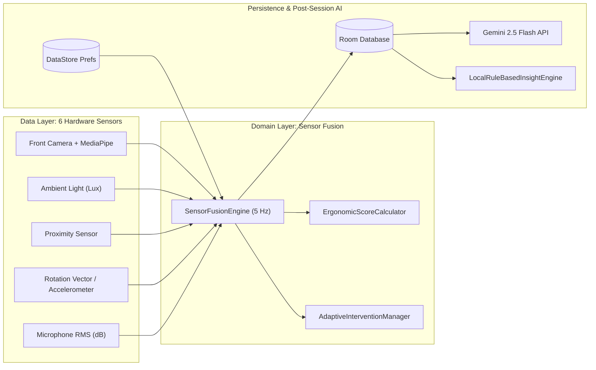

# LumiPosture

**Real-Time Eye Health & Study Ergonomics Assistant (Android Native)**

LumiPosture adalah aplikasi Android *digital health* dan *assistive ergonomics* berbasis **Sensor Fusion** dan **Hybrid AI** (*Pre-Trained On-Device Vision AI* + *Gemini Analytical AI*) untuk membantu pengguna menjaga kesehatan mata dan postur tulang leher secara *real-time* selama menggunakan HP.

---

## 1. Problem Statement

Penggunaan smartphone dan layar digital dalam durasi panjang sering memicu masalah kesehatan ergonomi yang tidak disadari secara langsung:

1. **Digital Eye Strain & Dry Eyes (Computer Vision Syndrome)**
   Saat fokus menatap layar, frekuensi kedipan mata manusia turun drastis dari rentang sehat **12–25 kedipan/menit (BPM)** menjadi **< 10 BPM**. Kondisi ini diperburuk oleh jarak pandang yang terlalu dekat serta kontras ekstrem antara layar terang dengan ruangan yang redup (*glare*).
2. **Sindrom Tech-Neck**
   Kebiasaan menunduk dengan sudut fleksi leher **>= 30 derajat** secara berkelanjutan saat memegang ponsel sambil duduk maupun berbaring memberikan beban mekanis ekstra hingga **18–27 kg** pada tulang leher bagian atas.
3. **Kurangnya Kesadaran Faktor Lingkungan Belajar**
   Penurunan konsentrasi dan kelelahan mata sering dipicu oleh kombinasi pencahayaan ruang yang kurang memadai (**< 80–100 Lux**) dan kebisingan latar belakang (**> 65 dB**).
4. **Keterbatasan Pengingat Statis Konvensional**
   Aplikasi pengingat istirahat biasa hanya mengandalkan *timer* statis (misalnya alarm 20 menit buta) tanpa memahami kondisi biologis mata, postur leher, maupun lingkungan belajar pengguna secara nyata.

---

## 2. Mengenal LumiPosture & Fungsi Aplikasi

LumiPosture hadir sebagai asisten ergonomi pasif (*non-intrusive*) tanpa memerlukan perangkat *wearable* tambahan. Aplikasi membaca dan menggabungkan sinyal dari **6 sensor perangkat keras smartphone** secara sinkron (*real-time* pada 5 Hz) untuk:

- **Memantau kondisi mata, jarak pandang, postur leher, pencahayaan, dan kebisingan** dalam satu layar sesi belajar.
- **Memberikan intervensi adaptif tepat waktu** berupa *floating frosted-glass banner*, getaran halus (*haptic*), dan modal jeda **20-20-20** dinamis ketika kelelahan mata atau postur berisiko terdeteksi.
- **Menganalisis korelasi sebab-akibat antar-sensor** setelah sesi berakhir melalui Gemini API (atau mesin aturan lokal saat offline) disertai grafik *time-series* dan 3 rekomendasi perbaikan konkret.
- **Menjaga privasi mutlak (*Privacy-by-Design*)**: seluruh inferensi wajah dan pengukuran amplitudo suara dijalankan **100% lokal di RAM perangkat** tanpa pernah menyimpan foto, video, atau rekaman audio ke penyimpanan maupun server.

---

## 3. Fitur Utama

1. **Quick Ergonomic Calibration & Hardware Diagnostic**
   - Kalibrasi *baseline* wajah selama **10 detik** pada jarak standar **30 cm** untuk merekam jarak antar-pupil (*Inter-Pupillary Distance* / IPD) unik pengguna.
   - Pemeriksaan otomatis ketersediaan 6 modul sensor perangkat dengan *graceful degradation* jika ada sensor yang tidak tersedia.
2. **Live Study Session & Real-Time Sensor Dashboard**
   - Pemilih posisi perangkat (**Handheld** vs **Desk Stand**) sebelum maupun selama sesi berlangsung.
   - **Live Ergonomic Gauge (0–100)** dan 5 kartu telemetri *real-time* (Jarak, Kedipan, Sudut Leher, Pencahayaan & Kecerahan Layar, serta Kebisingan).
   - Pratinjau kamera depan dengan *face mesh & iris overlay* minimalis yang dapat disembunyikan kapan saja tanpa menghentikan pemantauan.
3. **Adaptive Smart Intervention**
   - **Distance Alert:** Terpicu seketika jika *Proximity Sensor* aktif (`< 10 cm`) atau jika estimasi jarak kamera berada di bawah batas aman selama `> 5 detik`.
   - **Posture / Tech-Neck Alert:** Terpicu jika sudut fleksi leher melebihi ambang batas selama `> 15 detik` atau saat terdeteksi posisi membaca sambil tiduran pada mode *Handheld*.
   - **Glare Alert:** Terpicu jika ruangan redup (`< minLux`) sementara kecerahan layar tinggi (`> 65%`) selama `> 8 detik`.
   - **Dynamic 20-20-20 Eye Break:** Modal istirahat mata dengan hitung mundur 20 detik yang terpicu lebih cepat apabila *blink rate* turun di bawah 10 BPM dan mata menyipit (*squinting*).
4. **Post-Session AI Insight & Correlation Charts**
   - Grafik *time-series* interaktif berbasis **Vico Charts** dengan 3 mode tampilan (*Skor Ergonomi*, *Kedipan vs Cahaya*, dan *Sudut Leher vs Kebisingan*).
   - Kartu analisis terstruktur dari **Gemini 2.5 Flash** berisi status kesehatan sesi, faktor risiko utama, korelasi antar-sensor, dan 3 langkah perbaikan praktis.
   - *Offline Rule-Based Fallback* otomatis saat tidak ada koneksi internet atau API key belum diisi, dilengkapi tombol **Analisis Ulang dengan Gemini** saat perangkat kembali online.
5. **History & Weekly Ergonomic Trends**
   - Penyimpanan lokal menggunakan Room Database lengkap dengan grafik tren mingguan 7 hari, total durasi belajar sehat, dan daftar riwayat sesi.
6. **In-App Configuration & Telemetry Debug Overlay**
   - Konfigurasi **Gemini API Key langsung di dalam menu Setelan** (tersimpan aman di Jetpack DataStore perangkat).
   - Penyesuaian ambang batas jarak minimum, sudut leher maksimum, cahaya minimum, serta toggle getaran haptik.
   - Toggle aktif/nonaktif untuk masing-masing dari **6 modul sensor** (*Kamera Depan, Ambient Light, Proximity, Accelerometer, Gyroscope, Mikrofon*) di menu Setelan.
   - Toggle **Telemetry Debug** untuk menampilkan pembacaan sensor mentah ($\text{Lux}$, layar `%`, $\text{dB}$, $\text{IPD px}$, *pitch* perangkat/kepala, sudut leher, $\text{FPS}$, dan status *proximity*) secara langsung di layar sesi.

---

## 4. Arsitektur Sistem & Hybrid AI

LumiPosture menerapkan **Clean Architecture** yang terbagi menjadi 3 lapisan (**Presentation**, **Domain**, **Data**) dengan pola **MVVM** dan *reactive stream* (`Kotlin Flow` / `StateFlow`).



### Matriks Sensor Fusion & Pembobotan Skor

| Sensor | Metrik yang Dibaca | Peran dalam Sensor Fusion |
| :--- | :--- | :--- |
| **Front Camera** | Face landmarks, Iris IPD (`468`, `473`), `eyeBlink`, `eyeSquint`, Transformation Matrix | Inti Vision AI (*on-device* `face_landmarker.task` pada ~6–7 FPS, resolusi `480x640`). |
| **Ambient Light** | Intensitas cahaya ruang ($\text{Lux}$) | Dibandingkan dengan kecerahan layar sistem (`%`) untuk mendeteksi *Dim-Room Glare Risk*. |
| **Proximity** | Jarak objek dekat (`NEAR` / `cm`) | *Hardware Fail-Safe* yang langsung memicu *Critical Distance Warning* (`5 cm`) bila wajah terlalu menempel. |
| **Accelerometer** | Vektor gravitasi $(a_x, a_y, a_z)$ | Menghitung kemiringan perangkat ($\theta_{\text{device}}$) dan mendeteksi postur tiduran (*fallback* jika tidak ada Giroskop). |
| **Gyroscope** | `TYPE_ROTATION_VECTOR` | Menstabilkan sudut kemiringan HP tanpa *jitter* lalu digabung dengan *Head Pitch* AI untuk menghitung $\theta_{\text{neck}}$. |
| **Microphone** | Amplitudo PCM 16-bit ($\text{dB}$) | Sampling `200 ms` setiap `2 detik` di RAM untuk mengukur kebisingan ruangan tanpa merekam file audio. |

**Rumus Skor Ergonomi Real-Time ($E_{\text{score}} \in [0, 100]$):**

$$E_{\text{score}} = 0.25\,s_{\text{blink}} + 0.25\,s_{\text{distance}} + 0.25\,s_{\text{posture}} + 0.15\,s_{\text{lighting}} + 0.10\,s_{\text{noise}}$$

---

## 5. Tech Stack

| Komponen | Teknologi / Pustaka |
| :--- | :--- |
| **Bahasa & Concurrency** | Kotlin `2.4.21`, Coroutines & Flow (`StateFlow`, `combine`, `callbackFlow`) |
| **UI & Design System** | Jetpack Compose + Material 3 (`Compose BOM 2026.02.01`), Material Icons Extended |
| **Glassmorphism** | Haze `2.1.0` (`haze`, `haze-blur`) dengan *fallback* translusen untuk Android 8–11 |
| **Visualisasi Grafik** | Vico Charts `3.3.1` (`compose`, `compose-m3`) + Custom Compose `Canvas` |
| **Dependency Injection** | Dagger Hilt `2.60.1` + Hilt Navigation Compose `1.4.0` (KSP `2.3.6`) |
| **Kamera & Edge AI** | AndroidX CameraX `1.7.0` + Google MediaPipe Tasks Vision `0.10.29` (`face_landmarker.task`) |
| **Sensor & Audio** | Android `SensorManager` (`LIGHT`, `PROXIMITY`, `ROTATION_VECTOR`, `ACCELEROMETER`) & `AudioRecord` |
| **Persistensi Lokal** | Room Database `2.8.5` (`StudySession`, `TelemetrySample`, `AiInsight`) & Jetpack DataStore `1.3.0` |
| **Jaringan & Cloud AI** | Retrofit `3.0.0`, OkHttp `5.5.1`, Kotlinx Serialization `1.13.0`, Gemini API (`gemini-2.5-flash`) |
| **Target Platform** | Android Min SDK `26` (Android 8.0), Target SDK `35`, Compile SDK `37` |

---

## 6. Penjelasan Istilah di Aplikasi

| Istilah | Penjelasan |
| :--- | :--- |
| **Skor Ergonomi (`0–100`)** | Indeks gabungan *real-time* dari lima aspek kesehatan belajar (kedipan, jarak, postur leher, pencahayaan, kebisingan). Skor `>= 80` berstatus **Optimal**, `60–79` **Waspada**, dan `< 60` **Berisiko**. |
| **BPM (Blinks Per Minute)** | Jumlah kedipan mata sah per menit yang dihitung menggunakan *sliding window* 60 detik. Rentang sehat adalah **12–25 BPM**; nilai **< 10 BPM** menandakan kelelahan/mata kering. |
| **IPD (Inter-Pupillary Distance)** | Jarak antar-titik tengah iris kiri (landmark `468`) dan kanan (landmark `473`) dalam piksel (`px`). Dipakai untuk mengestimasi jarak wajah ke layar ($D_{\text{cam}} = D_0 \times W_0 / W_{\text{current}}$) dengan *baseline* standar $D_0 = 30\text{ cm}$. |
| **Squinting** | Skor rata-rata penyipitan kelopak mata (`eyeSquintLeft` & `eyeSquintRight`). Nilai tinggi yang disertai kedipan rendah menandakan ketegangan mata akibat silau atau teks terlalu kecil. |
| **Head Pitch & Device Pitch** | *Head Pitch* ($\theta_{\text{head\_pitch}}$) adalah sudut anggukan kepala terhadap kamera dari matriks transformasi wajah 3D; *Device Pitch* ($\theta_{\text{device}}$) adalah kemiringan bodi ponsel terhadap sumbu vertikal. |
| **Sudut Leher / Tech-Neck ($\theta_{\text{neck}}$)** | Hasil penjumlahan $\theta_{\text{device}} + \theta_{\text{head\_pitch}}$ yang dibatasi pada `0–90 derajat`. Sudut **>= 30 derajat** diklasifikasikan sebagai risiko *Tech-Neck*. |
| **Lux & Glare Risk** | **Lux** (`lx`) adalah satuan intensitas pencahayaan ruangan (optimal belajar **150–500 Lux**). **Glare Risk** terjadi ketika ruangan redup (`< minLux`) sementara kecerahan layar tinggi (`> 65%`). |
| **Desibel (dB)** | Estimasi tingkat kebisingan ambien berdasarkan *Root Mean Square* (RMS) sinyal mikrofon. Lingkungan tenang berada di kisaran **30–45 dB**, sedangkan **> 65 dB** ditandai sebagai zona gangguan fokus. |
| **Proximity Fail-Safe** | Pengaman berbasis sensor jarak inframerah perangkat keras. Jika kamera gagal melacak wajah utuh karena layar terlalu menempel (`< 10 cm`), sensor ini langsung mengunci estimasi jarak ke `5 cm` dan memicu peringatan kritis. |
| **Sensor Fusion & EMA** | Penggabungan multi-sensor yang diperhalus dengan *Exponential Moving Average* (EMA) agar angka metrik pada layar tetap stabil dan bebas lonjakan (*jitter*). |
| **Mode Handheld vs Desk Stand** | Pilihan posisi belajar pada Beranda atau Sesi Aktif. *Handheld* mengaktifkan deteksi postur membaca sambil tiduran, sedangkan *Desk Stand* mengasumsikan ponsel ditopang penyangga meja. |
| **Aturan 20-20-20** | Prinsip ergonomi mata: setiap 20 menit menatap layar, alihkan pandangan ke objek berjarak 20 kaki (~6 meter) selama 20 detik. Pada LumiPosture, jeda ini juga dapat terpicu lebih dini secara adaptif jika mata lelah. |
| **Telemetry Debug** | Mode presentasi/pengujian di menu **Setelan** yang menampilkan nilai mentah seluruh sensor secara langsung ($\text{Lux}$, `%` layar, $\text{dB}$, $\text{IPD px}$, *pitch*, dan $\text{FPS}$ inferensi Vision AI). |
| **Tabular Numerals (`tnum`)** | Format angka dengan lebar karakter seragam agar tampilan metrik yang diperbarui 5 kali per detik tidak bergeser ke kiri/kanan. |

---

## 7. Struktur Direktori Utama

```text
app/src/main/
├── assets/face_landmarker.task            # Model pre-trained MediaPipe Face Landmarker
└── java/com/lumiposture/app/
    ├── LumiPostureApp.kt                  # Entry point Hilt (@HiltAndroidApp)
    ├── MainActivity.kt                    # Edge-to-edge host & startup routing
    ├── di/                                # Module DI (Database, Network, Sensor)
    ├── data/
    │   ├── local/                         # Room DB (DAO, Entities) & DataStore Preferences
    │   ├── remote/                        # Retrofit Gemini API service & DTO JSON
    │   ├── repository/                    # Implementasi repositori sesi & insight
    │   └── sensor/                        # FaceLandmarkerHelper, EnvironmentSensorManager, NoiseLevelSampler
    ├── domain/
    │   ├── engine/                        # SensorFusionEngine, ScoreCalculator, InterventionManager, LocalFallback
    │   ├── model/                         # SensorSnapshot, ActiveAlert, SessionReport, UserPreferences
    │   └── usecase/                       # AnalyzeSessionWithAiUseCase, CalculateBaselineCalibrationUseCase
    └── presentation/
        ├── components/                    # GlassSurface (Haze), FloatingPillNavBar, PillSegmentedControl, TabularMetricText
        ├── onboarding/                    # CalibrationScreen & CalibrationViewModel
        ├── home/                          # HomeDashboardScreen & HomeViewModel
        ├── session/                       # ActiveSessionScreen, SessionViewModel & HUD components
        ├── report/                        # SessionReportScreen, ReportViewModel & CorrelationLineChart (Vico)
        ├── history/                       # HistoryScreen & HistoryViewModel
        ├── settings/                      # SettingsScreen & SettingsViewModel
        ├── navigation/                    # NavGraph & route definitions
        └── theme/                         # Color, Shape, Typography & Theme tokens
```

---

## 8. Instalasi, Build & Konfigurasi

### Prasyarat
- **Android Studio** (terbaru, kompatibel AGP `9.3.3` & Gradle `9.5.0`)
- **JDK 21 / 25** (sesuai `gradle-daemon-jvm.properties`)
- Perangkat Android fisik (disarankan Android 8.0+ / Android 12+ untuk *backdrop blur* native dan pembacaan sensor hardware nyata)

### Langkah Menjalankan Proyek

1. **Clone repositori**
   ```bash
   git clone https://github.com/imdfauzan/Pemmob-FP.git
   cd Pemmob-FP
   ```
2. **Buka di Android Studio** atau jalankan build melalui terminal:
   ```bash
   ./gradlew :app:testDebugUnitTest
   ./gradlew :app:assembleDebug
   ```
   Hasil APK debug tersedia di `app/build/outputs/apk/debug/app-debug.apk`.
3. **Konfigurasi Gemini API Key (Di Dalam Aplikasi)**
   - Tidak perlu menyimpan API key di file konfigurasi kode sumber.
   - Buka aplikasi **LumiPosture** -> masuk ke tab **Setelan** -> isi kolom **Konfigurasi Gemini API Key** lalu tekan **Simpan API Key**.
   - Jika API key belum diisi atau perangkat sedang offline, aplikasi tetap berjalan normal menggunakan **Local Rule-Based Insight Engine** dan hasil sesi dapat dianalisis ulang kapan saja setelah API key dan koneksi internet tersedia.
