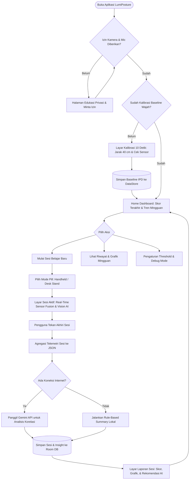
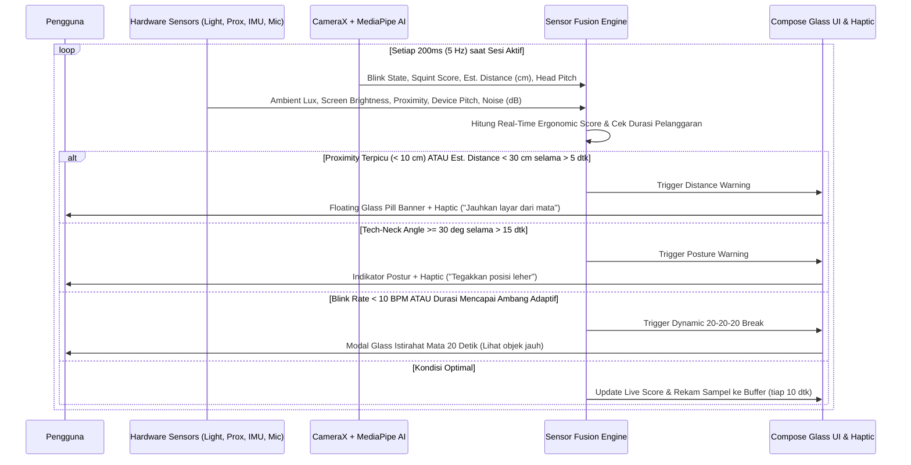

# Product Requirements Document (PRD): LumiPosture

**Nama Aplikasi:** LumiPosture — Real-Time Eye Health & Study Ergonomics Assistant  
**Target Platform:** Android (Minimum SDK 26 / Android 8.0, Target SDK 35)  
**Kategori:** Digital Health, Assistive Ergonomics, Edge AI & Sensor Fusion  

---

## 1. Executive Summary & Product Vision

**LumiPosture** adalah aplikasi mobile pintar yang berfungsi sebagai asisten kesehatan mata dan ergonomi belajar/bekerja secara *real-time*. Aplikasi ini memanfaatkan **Sensor Fusion** dari 6 sensor perangkat keras smartphone (Kamera Depan, Ambient Light, Proximity, Accelerometer, Gyroscope, dan Mikrofon) yang dipadukan dengan arsitektur **Hybrid AI** (Pre-Trained On-Device Vision AI + Gemini API Analytical AI) untuk mencegah *Digital Eye Strain* (Computer Vision Syndrome) dan *Tech-Neck* (nyeri leher akibat postur menunduk).

Berbeda dengan aplikasi *timer* istirahat biasa (seperti pengingat 20-20-20 statis), LumiPosture **memahami kondisi fisik pengguna dan lingkungan belajarnya secara nyata**, memberikan intervensi adaptif saat risiko terjadi, lalu menghasilkan laporan analisis korelasi multi-sensor di akhir sesi.

---

## 2. Problem Statement & Value Proposition

### Masalah Nyata
1. **Digital Eye Strain & Dry Eyes:** Saat fokus menatap layar HP/laptop dalam waktu lama, frekuensi kedipan mata manusia turun drastis dari normal ($15\text{--}20$ kedipan/menit) menjadi $< 8$ kedipan/menit. Kondisi ini diperburuk oleh jarak pandang terlalu dekat ($< 30\text{ cm}$) dan kontras ekstrem antara layar terang dengan ruangan redup.
2. **Sindrom Tech-Neck:** Sudut menunduk leher yang terus-menerus ($\ge 30^\circ$) saat menggunakan HP sambil duduk atau tiduran memberikan beban ekstra hingga $18\text{--}27\text{ kg}$ pada tulang leher bagian atas.
3. **Kurangnya Kesadaran Lingkungan:** Pengguna jarang menyadari bahwa penurunan fokus dan pusing saat belajar dipicu oleh gabungan pencahayaan kurang memadai ($< 100\text{ Lux}$) dan kebisingan latar belakang ($> 65\text{ dB}$).

### Solusi
* **Passive & Non-Intrusive Monitoring:** Memantau mata, postur, cahaya, dan suara dalam satu mode sesi belajar tanpa perangkat tambahan (*wearable*).
* **Privacy-by-Design:** Seluruh pemrosesan wajah dan suara dilakukan **100% lokal di perangkat (Edge AI)**. Tidak ada foto, video, atau rekaman audio mentah yang disimpan atau dikirim ke server.
* **Actionable AI Analytics:** Bukan sekadar angka mentah, melainkan diagnosis korelasi antar-sensor yang ringkas dan dapat langsung ditindaklanjuti pengguna.

---

## 4. Arsitektur Implementasi AI (Hybrid AI)

### Layer 1: Pre-Trained On-Device Vision AI (Core Engine — Wajib di MVP)
* **Peran:** Otak utama selama sesi belajar berlangsung (*real-time inference*, bekerja 100% offline, bebas kuota/limit API, latensi rendah).
* **Teknologi:** **Google MediaPipe Face Landmarker** (file `face_landmarker.task` di folder `assets/`).

* **Yang dihitung oleh AI secara langsung?**
  1. **Deteksi Kedipan & Kelelahan Mata:** Membaca nilai *blendshapes* (`eyeBlinkLeft`, `eyeBlinkRight`, `eyeSquintLeft`, `eyeSquintRight`) untuk menghitung *Blink Rate* per menit dan mendeteksi mata tegang (*squinting*).
  2. **Estimasi Jarak Wajah ke Layar:** Menghitung jarak antar-iris/pupil (*Inter-Pupillary Distance* / IPD) dalam piksel untuk mengestimasi jarak wajah dalam sentimeter ($\text{cm}$).
  3. **Estimasi Orientasi Kepala (*Head Pose*):** Menggunakan *Face Transformation Matrix* untuk membaca sudut anggukan kepala (*head pitch*), yang kemudian digabung dengan sensor kemiringan HP.

### Layer 2: Generative Analytical AI via Gemini API (Post-Session Engine — Wajib di MVP)
* **Peran:** **Bukan chatbot bebas**, melainkan **Automated Data Analyst & Ergonomic Coach** yang menganalisis rangkuman data numerik dari 6 sensor setelah sesi belajar selesai.
* **Teknologi:** **Gemini API (`gemini-2.5-flash`)** dengan *Structured JSON Output* (cukup bermodal `GEMINI_API_KEY`).
* **Apa yang dilakukan AI ini?**
  1. **Analisis Korelasi Multi-Sensor:** Menerima payload JSON ringkasan telemetri sesi (rata-rata Lux, rasio kecerahan layar, tren *blink rate*, durasi *tech-neck*, puncak dB) lalu menyimpulkan akar masalah kelelahan pengguna.
     * *Contoh Output Nyata:* "Skor ergonomimu turun di 15 menit terakhir karena pencahayaan ruangan meredup ke 42 Lux saat kecerahan layar tetap 85%. Kondisi ini memicu mata menyipit dan menurunkan kedipan ke 7x/menit."
  2. **Penjelasan Skor & Rekomendasi Konkret:** Menghasilkan 3 saran perbaikan spesifik untuk sesi berikutnya.
  3. **Fallback Offline:** Jika perangkat tidak terkoneksi internet saat sesi selesai, aplikasi otomatis menggunakan *Local Deterministic Rule-Based Engine* untuk menampilkan ringkasan dan menandai sesi agar bisa dianalisis ulang oleh Gemini saat online.

### Layer 3 (Post-MVP / Opsional): Grounded Ergonomic Q&A (via Gemini API)
* Fitur tanya-jawab terbatas di halaman laporan, di mana pengguna dapat bertanya hal spesifik terkait data historinya (misal: *"Kenapa skor mata saya lebih rendah hari Selasa?"*), dan Gemini menjawab berdasarkan data histori lokal pengguna (*grounded*).

---

## 5. Matriks Sensor Fusion (6 Sensor Hardware)

Setiap sensor memiliki peran fungsional yang saling mengunci (*fusion*) agar tidak terjadi *false positive*:

| No | Sensor Hardware | Metrik yang Dibaca | Peran dalam Sensor Fusion & Ambang Batas (Threshold) |
| :--- | :--- | :--- | :--- |
| **1** | **Front Camera** | Face landmarks, iris IPD, blink blendshapes, head pitch | Inti Vision AI. Memicu peringatan *Dry Eye* jika *blink rate* $< 10\text{ BPM}$ selama $2$ menit berturut-turut, atau jarak estimasi $< 30\text{ cm}$. |
| **2** | **Ambient Light Sensor** | Intensitas cahaya ruang ($\text{Lux}$) | Dibandingkan dengan tingkat kecerahan layar HP (`Screen Brightness %`). Memicu *Glare Alert* jika cahaya ruang $< 80\text{ Lux}$ tetapi layar $> 65\%$. |
| **3** | **Proximity Sensor** | Jarak objek dekat ($\text{cm}$ / biner dekat-jauh) | *Hardware Fail-Safe*. Jika wajah sangat dekat ($< 10\text{ cm}$, misal membaca sambil tiduran) hingga kamera gagal mendeteksi wajah utuh, Proximity langsung memicu *Critical Distance Warning*. |
| **4** | **Accelerometer** | Vektor gravitasi $(a_x, a_y, a_z)$ | Menghitung sudut kemiringan HP ($\theta_{\text{device}}$) terhadap bidang horizontal dan mendeteksi kondisi penggunaan sambil tiduran (*lying down posture*). |
| **5** | **Gyroscope** | Kecepatan sudut $(\omega_x, \omega_y, \omega_z)$ | Dipadukan dengan Accelerometer (`Rotation Vector`) untuk menstabilkan bacaan sudut kemiringan tanpa *jitter*, lalu difusikan dengan *Head Pitch* AI untuk mendeteksi *Tech-Neck* ($\theta_{\text{neck}} \ge 30^\circ$). |
| **6** | **Microphone** | Amplitudo suara ambien ($\text{dB}$) | Mengukur tingkat kebisingan lingkungan belajar secara periodik (tanpa menyimpan rekaman audio). Kebisingan $> 65\text{ dB}$ ditandai sebagai *Focus Distraction Zone* pada grafik sesi. |

---

## 6. Spesifikasi Fitur & Prioritas (MVP vs Post-MVP)

### A. Core Features (MVP)
1. **F1 — Quick Ergonomic Calibration (Onboarding):**
   * Kalibrasi 10 detik: pengguna memegang HP pada jarak nyaman ($\approx 40\text{ cm}$) untuk mencatat *baseline* IPD wajah.
   * Pengecekan ketersediaan sensor perangkat secara otomatis (*Hardware Sensor Diagnostic Check*).
2. **F2 — Live Study Session & Real-Time Sensor Dashboard:**
   * Mode sesi belajar dengan 2 pilihan posisi dalam kontrol *pill-segmented*: **Handheld** dan **Desk Stand**.
   * Menampilkan *Live Ergonomic Gauge* (Skor Kesehatan Real-Time $0\text{--}100$), kartu ringkas 5 metrik (Jarak, Kedipan, Postur Leher, Pencahayaan, Kebisingan), serta pratinjau kamera dengan *face mesh overlay* minimalis yang bisa disembunyikan (*toggle*).
3. **F3 — Adaptive Smart Intervention (Peringatan Non-Mengganggu):**
   * *Floating Pill Shaped Banner* di bagian atas layar + getaran lembut (*haptic*) saat postur menunduk $> 15$ detik atau jarak terlalu dekat $> 5$ detik.
   * **Dynamic 20-20-20 Eye Break:** Pengingat istirahat mata dipicu lebih cepat jika AI mendeteksi *blink rate* rendah dan *squinting* tinggi, disertai modal hitung mundur $20$ detik melihat objek jauh ($20\text{ kaki} \approx 6\text{ meter}$).
4. **F4 — Post-Session AI Insight & Correlation Charts:**
   * Setelah sesi diakhiri, aplikasi menyimpan rangkuman telemetri ke database lokal dan mengirim payload JSON ke Gemini API.
   * Menampilkan **Ergonomic Wellness Score ($0\text{--}100$)**, **Grafik Time-Series** (tren *Blink Rate* vs *Lux/Noise*), dan **Kartu Analisis AI** berisi ringkasan korelasi + 3 rekomendasi aksi.
5. **F5 — History & Weekly Ergonomic Trends:**
   * Daftar riwayat sesi belajar lokal, grafik tren skor mingguan, dan total durasi belajar sehat.
6. **F6 — Demo / Debug Telemetry Overlay (Khusus Presentasi Sidang):**
   * *Toggle* minimalis di Settings untuk menampilkan angka mentah seluruh sensor secara langsung ($\text{Lux}$, $\text{dB}$, $\text{Pitch}^\circ$, $\text{IPD px}$, $\text{FPS}$) guna membuktikan kepada dosen penguji bahwa sensor dan Vision AI bekerja *real-time*.

### B. Post-MVP Features (Di skip dulu)
1. **Floating Overlay Mode (Background Service):** Pemantauan tetap berjalan lewat *pill indicator* mengambang kecil saat pengguna membuka aplikasi lain.
2. **Grounded AI Q&A Assistant:** Tab tanya-jawab berbasis data histori mingguan via Gemini API.
3. **Export Laporan PDF:** Ekspor laporan kesehatan mata mingguan.

---

## 7. UI/UX Design Language & Anti-AI-Slop Guidelines

> **Aturan Mutlak UI:** Seluruh UI LumiPosture harus terasa seperti aplikasi *digital health* flagship iOS modern—tenang, klinis namun hangat, presisi, dan sangat bersih. **Dilarang keras menghasilkan desain bergaya "AI Slop".**

### 7.1 Identitas Visual (iOS-Inspired Glassmorphism & Pill-Shaped)
* **Surface & Material (Liquid / Frosted Glass):**
  * Gunakan kanvas latar solid yang bersih (Light Mode: *Cool Alabaster* `#F4F5F7`; Dark Mode: *Obsidian Slate* `#0B0D11`).
  * Komponen mengambang (Navigasi Bawah, *HUD* di atas kamera, *Alert Banner*, *Modal Sheet*) menggunakan permukaan kaca transparan (*frosted glass*) dengan *backdrop blur* halus, opasitas terkontrol ($65\%\text{--}80\%$), dan garis tepi tipis (*hairline stroke* $0.75\text{--}1\text{ dp}$) berwarna putih transparan (`rgba(255,255,255,0.35)` di Light / `0.12` di Dark) untuk efek refraksi kaca yang elegan.
* **Geometri Pill-Shaped:**
  * **Floating Pill Bottom Navigation Bar:** Melayang $16\text{ dp}$ dari tepi bawah layar dengan sudut kapsul penuh (`CircleShape` / `RoundedCornerShape(50)`), tanpa garis pembatas penuh dari kiri ke kanan.
  * **Primary & Secondary Buttons:** Seluruh tombol aksi utama, *segmented control* (Handheld / Desk Stand), dan *alert banner* berbentuk kapsul (*pill-shaped*).
  * **Cards:** Sudut membulat konsisten ($24\text{ dp}$) dengan *padding* lapang ($20\text{ dp}$) dan jarak antar-elemen lega (*generous whitespace*).
* **Palet Warna Terkendali (Restrained & Functional):**
  * **Tanpa gradasi mencolok.** Seluruh warna solid dan tenang.
  * **Single Primary Accent:** *Clinical Blue* (`#1D63ED` di Light / `#4B8BFF` di Dark) hanya untuk aksi utama dan elemen aktif.
  * **Semantic Status Colors (Muted, hanya muncul pada status metrik):**
    * Optimal: *Sage Emerald* (`#16A34A` / `#34D399`)
    * Waspada: *Warm Amber* (`#D97706` / `#FBBF24`)
    * Risiko: *Soft Crimson* (`#DC2626` / `#F87171`)
* **Tipografi & Data Presisi:**
  * Gunakan font *sans-serif* geometris bersih (`Inter` atau *system default* `Roboto` dengan *tight tracking* pada judul besar).
  * **Wajib Tabular Figures (`tnum`):** Seluruh angka metrik sensor yang berubah *real-time* ($\text{cm}$, $\text{Lux}$, $\text{dB}$, $\text{BPM}$, $^\circ$, skor) wajib memakai *tabular numerals* agar lebar angka konstan dan tidak bergetar (*layout jitter*) saat diperbarui.

### 7.2 Daftar Larangan Keras (Anti-AI-Slop Guardrails)
1. **DILARANG MENGGUNAKAN EMOJI** di mana pun dalam kode UI, label tombol, judul kartu, maupun output teks AI (tidak ada ikon mata, api, kilau/sparkle, bintang, atau centang emoji). Gunakan hanya ikon vektor monokrom bergaris tipis (*Material Symbols Rounded* / *Lucide Vector*).
2. **DILARANG MENGGUNAKAN GRADASI DEKORATIF:** Tidak ada latar belakang gradasi ungu-biru-pink, tidak ada tombol gradasi neon, dan tidak ada *ambient glowing blobs* / lingkaran cahaya buram hiasan di belakang kartu.
3. **DILARANG MENAMBAH BADGE/CHIP SAMPAH:** Tidak ada *pill badge* tidak fungsional seperti `"AI Powered"`, `"Smart Engine"`, `"Beta"`, `"Live ✨"`, atau ikon kilau (*sparkles*) di sebelah teks.
4. **DILARANG MENUMPUK KARTU DALAM KARTU:** Maksimal 1 level kontainer per bagian agar hierarki visual tetap datar, ringan, dan langsung fokus pada data kesehatan pengguna.

---

## 8. User Flow (Mermaid Diagrams)

### 8.1 Main Application & Onboarding Flow

### 8.2 Real-Time Monitoring & Intervention Loop (During Active Session)

---

## 9. Non-Functional Requirements (NFR)

1. **Privasi & Keamanan Data:**
   * Frame kamera diproses di RAM menggunakan `ImageProxy` dan langsung di-*close* setelah inferensi; tidak pernah ditulis ke *storage*.
   * Mikrofon hanya membaca nilai amplitudo RMS untuk konversi ke $\text{dB}$, tanpa merekam file audio (`.mp3`/`.wav`).
2. **Efisiensi Baterai & Termal:**
   * Inferensi MediaPipe Face Landmarker di-*throttle* ke $5\text{--}7\text{ FPS}$ (cukup akurat menangkap kedipan mata berdurasi $100\text{--}400\text{ ms}$, memangkas beban CPU/GPU hingga $> 70\%$ dibanding $30\text{ FPS}$).
   * Resolusi kamera untuk analisis dikunci pada resolusi rendah ($480 \times 640\text{ px}$).
3. **Graceful Degradation:**
   * Jika perangkat uji tidak memiliki sensor Gyroscope, perhitungan kemiringan otomatis beralih ke `Accelerometer` dengan *low-pass filter*.
   * Efek *backdrop blur* glassmorphism berjalan penuh di Android 12+ (API 31+) dan otomatis jatuh ke permukaan translusen presisi tinggi tanpa *crash* di Android 8–11 (API 26–30).

---