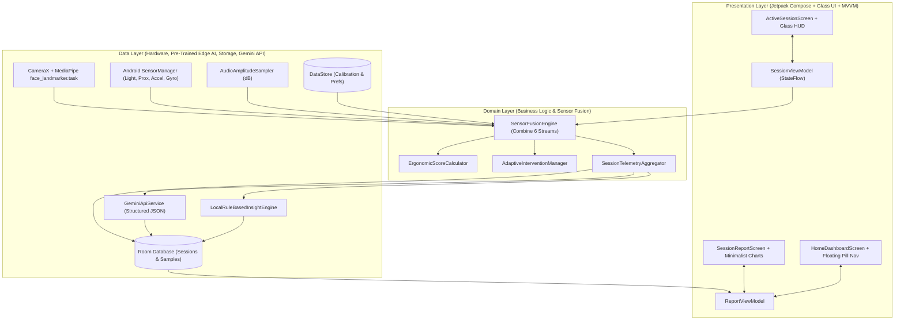
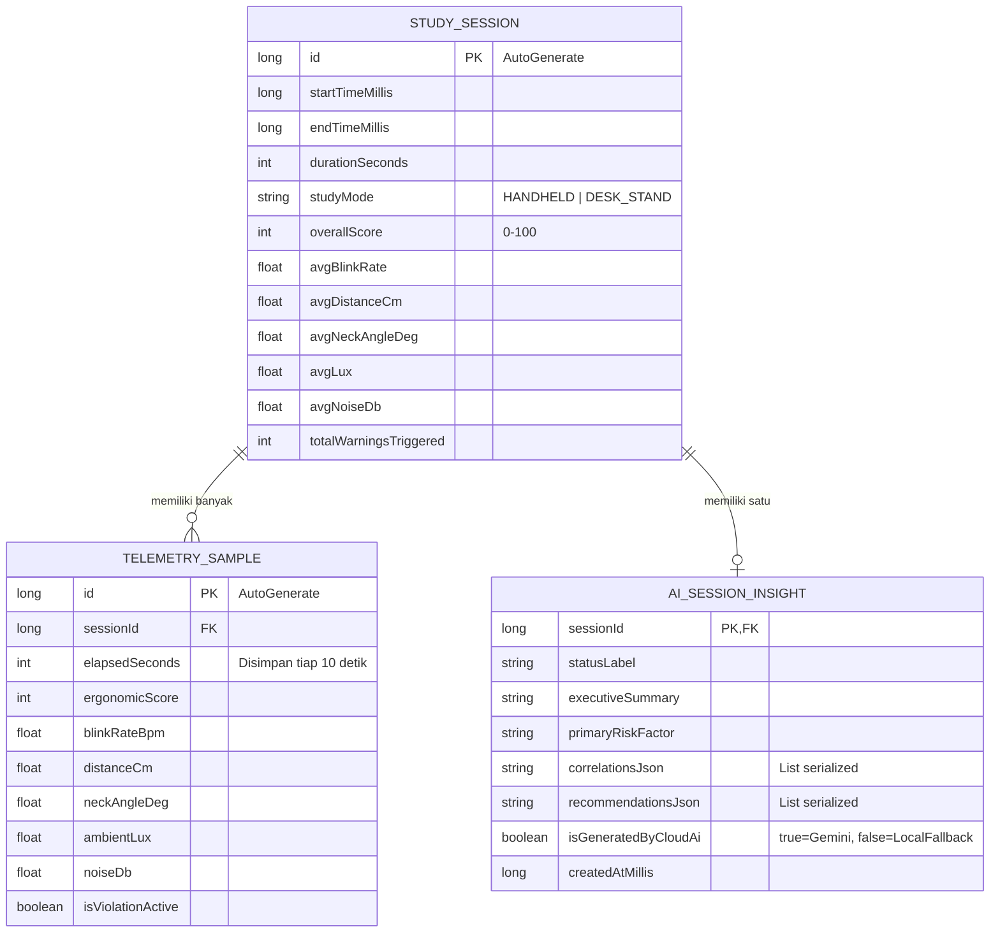

# Technical Specification & System Architecture: LumiPosture

**Target Pembaca:** AI Coding Agent (Antigravity)    
**Platform:** Android Native (Kotlin + Jetpack Compose)  
**Arsitektur:** Clean Architecture + MVVM + Reactive Streams (`StateFlow`)  

---

## 1. Tech Stack & Rationale

Penggunaan **Android Native (Kotlin + Jetpack Compose)** karena proyek ini bergantung pada sinkronisasi 6 sensor hardware (*low-level Hardware SensorManager*) dan pemrosesan *frame* kamera *real-time* low latency.

| Layer | Teknologi / Library | Alasan Pemilihan |
| :--- | :--- | :--- |
| **Language** | Kotlin 2.0+ (Coroutines & Flow) | *Concurrency* ringan untuk menggabungkan 6 aliran data sensor secara asinkron (`combine` / `StateFlow`). |
| **UI Framework** | Jetpack Compose + Material 3 | UI deklaratif modern, mudah di-generate oleh AI Agent, mendukung animasi *gauge* & *overlay* kustom (`Canvas`). |
| **Glassmorphism Blur** | **Haze** (`dev.chrisbanes.haze:haze`) | Memberikan efek *real-time frosted glass / backdrop blur* ala iOS terbaru secara native di Compose (Android 12+ real blur) |
| **Iconography** | Material Symbols Rounded (`material-icons-extended`) | Ikon vektor garis tipis yang konsisten; menggantikan seluruh penggunaan emoji (anti-AI-slop). |
| **Dependency Injection** | Dagger Hilt (`hilt-android`, `hilt-navigation-compose`) | Memudahkan injeksi `SensorManager`, `RoomDatabase`, dan `Repository` serta *testing*. |
| **Camera Pipeline** | AndroidX CameraX (`camera-core`, `camera-camera2`, `camera-lifecycle`, `camera-view`) | Manajemen siklus hidup kamera otomatis dan akses langsung ke `ImageAnalysis`. |
| **On-Device Vision AI** | Google MediaPipe Tasks Vision (`com.google.mediapipe:tasks-vision`) | **Zero-Training:** Pakai file pre-trained `face_landmarker.task` di `assets/` untuk membaca kedipan mata, iris IPD, dan sudut kepala secara offline. |
| **Analytical Cloud AI** | Gemini API (`gemini-2.5-flash`) via Retrofit + OkHttp + Kotlinx Serialization | **Zero-Training:** Pakai `GEMINI_API_KEY`. Mendukung *Structured JSON Output* (`responseSchema`), cepat, dan akurat merangkum telemetri. |
| **Hardware Sensors** | Android `SensorManager` + `AudioRecord` | Akses langsung ke `TYPE_LIGHT`, `TYPE_PROXIMITY`, `TYPE_ACCELEROMETER`, `TYPE_GYROSCOPE`, `TYPE_ROTATION_VECTOR`, dan RMS audio. |
| **Local Database** | Room Database + Jetpack DataStore (Preferences) | Room untuk histori sesi & titik grafik *time-series*; DataStore untuk pengaturan & nilai kalibrasi *baseline* IPD. |
| **Data Visualization** | Vico Charts (`com.patrykandpatrick.vico:compose-m3`) atau Custom Compose `Canvas` | Ringan dan natif untuk Jetpack Compose guna merender grafik garis korelasi yang minimalis tanpa ornamen berlebih. |

---

## 2. System Architecture Diagram

Aplikasi menggunakan pola **Clean Architecture** yang terbagi menjadi 3 lapisan utama: **Presentation (UI/ViewModel)**, **Domain (Sensor Fusion & Use Cases)**, dan **Data (Hardware Sources, Local DB, Remote AI API)**.



---

## 3. Sensor Fusion & Rumus Matematis

Bagian ini menjadi acuan untuk AI Agent saat menulis implementasi di lapisan `domain`.

### 3.1 Deteksi Kedipan Mata (*Blink Detection*)
MediaPipe `FaceLandmarker` (dengan `outputFaceBlendshapes = true`) mengembalikan skor probabilitas $[0.0, 1.0]$ untuk `eyeBlinkLeft` ($B_L$) dan `eyeBlinkRight` ($B_R$).
* **Kondisi Mata Tertutup:**
  $$B_{\text{avg}} = \frac{B_L + B_R}{2} > 0.50$$
* **Definisi 1 Kedipan Sah:** Transisi dari kondisi terbuka ($B_{\text{avg}} < 0.30$) $\rightarrow$ tertutup ($B_{\text{avg}} > 0.50$) $\rightarrow$ kembali terbuka ($B_{\text{avg}} < 0.30$) dalam rentang waktu $80\text{ ms} \le \Delta t \le 500\text{ ms}$. (Jika $> 1500\text{ ms}$, diklasifikasikan sebagai *drowsiness / eyes closed*, bukan kedipan normal).
* **Blink Rate (BPM):** Dihitung menggunakan *sliding window* $60$ detik:
  $$\text{BPM} = \text{Jumlah kedipan dalam } 60\text{ detik terakhir}$$
  Ambang sehat: $12 \le \text{BPM} \le 25$. Ambang peringatan *Eye Strain*: $\text{BPM} < 10$.

### 3.2 Estimasi Jarak Wajah ke Layar (*Distance Fusion*)
Menggunakan kalibrasi jarak *baseline* ($D_0 = 40\text{ cm}$) saat *onboarding* yang merekam jarak antar-iris/pupil dalam piksel ($W_0$) menggunakan titik *landmark* iris kiri (`468`) dan iris kanan (`473`).
* **Estimasi Jarak Kamera ($D_{\text{cam}}$):**
  $$D_{\text{cam}} = D_0 \times \frac{W_0}{W_{\text{current}}}$$
  di mana $W_{\text{current}} = \sqrt{(x_{473} - x_{468})^2 + (y_{473} - y_{468})^2}$.
* **Sensor Fusion dengan Proximity ($D_{\text{final}}$):**
  * Jika `ProximitySensor` bernilai `NEAR` ($< \text{maxRange}$ atau $< 5\text{ cm}$), maka $D_{\text{final}} = 5\text{ cm}$ (*Critical Alert*).
  * Jika tidak, gunakan rata-rata bergerak (*Exponential Moving Average*, $\alpha = 0.3$) dari $D_{\text{cam}}$.
  * Ambang terlalu dekat: $D_{\text{final}} < 30\text{ cm}$.

### 3.3 Deteksi Postur Leher (*Tech-Neck Angle Fusion*)
Menggabungkan sudut kemiringan HP dari `Sensor.TYPE_ROTATION_VECTOR` (atau fallback `Accelerometer`) dengan sudut anggukan kepala (*Head Pitch*) dari matriks transformasi wajah MediaPipe (`facialTransformationMatrixes`).
* **Sudut Kemiringan Perangkat ($\theta_{\text{device}}$):**
  Diukur dari sudut *pitch* perangkat relatif terhadap garis vertikal ($0^\circ$ = HP berdiri tegak sejajar mata, $90^\circ$ = HP telentang rata di meja).
  Jika fallback menggunakan Accelerometer saja:
  $$\theta_{\text{device}} = \arctan2\left(a_z, \sqrt{a_x^2 + a_y^2}\right) \times \frac{180^\circ}{\pi}$$
* **Estimasi Sudut Fleksi Leher ($\theta_{\text{neck}}$):**
  $$\theta_{\text{neck}} = \text{clamp}\left(\theta_{\text{device}} + \theta_{\text{head\_pitch}}, \, 0^\circ, \, 90^\circ\right)$$
  * **Normal:** $\theta_{\text{neck}} < 20^\circ$
  * **Waspada:** $20^\circ \le \theta_{\text{neck}} < 30^\circ$
  * **Tech-Neck Risk:** $\theta_{\text{neck}} \ge 30^\circ$ (dipertahankan $> 15$ detik).

### 3.4 Kontras Pencahayaan (*Lighting & Glare Risk*)
Mengambil bacaan `Sensor.TYPE_LIGHT` ($L$ dalam $\text{Lux}$) dan kecerahan layar sistem ($S \in [0, 100]\%$ dari `Settings.System.SCREEN_BRIGHTNESS / 255.0`).
* **Dim-Room Glare Risk:** $L < 80\text{ Lux}$ dan $S > 65\%$.
* **Too Dark Warning:** $L < 40\text{ Lux}$.
* **Optimal Study Lighting:** $150\text{ Lux} \le L \le 500\text{ Lux}$.

### 3.5 Kebisingan Ambien (*Ambient Noise in dB*)
Mengambil sampel *buffer* PCM 16-bit selama $200\text{ ms}$ setiap $2$ detik via `AudioRecord` (tanpa menulis file).
* **Root Mean Square (RMS) & Desibel Relatif:**
  $$\text{RMS} = \sqrt{\frac{1}{N} \sum_{i=1}^{N} x_i^2}$$
  $$\text{dB}_{\text{est}} = 20 \times \log_{10}\left(\frac{\text{RMS}}{P_{\text{ref}}}\right) + C_{\text{offset}}$$
  *(dengan $P_{\text{ref}} = 1.0$ dan konstanta kalibrasi $C_{\text{offset}}$ agar ruang tenang berada di kisaran $30\text{--}40\text{ dB}$ dan keramaian di $> 65\text{ dB}$).*

### 3.6 Skor Kesehatan Ergonomi Real-Time ($E_{\text{score}} \in [0, 100]$)
Skor dihitung sebagai rata-rata terbobot dari 5 sub-skor ($s_i \in [0, 100]$):
$$E_{\text{score}} = 0.25 \, s_{\text{blink}} + 0.25 \, s_{\text{distance}} + 0.25 \, s_{\text{posture}} + 0.15 \, s_{\text{lighting}} + 0.10 \, s_{\text{noise}}$$

---

## 4. Blueprint Implementasi AI (Zero-Training)

### 4.1 Layer 1: Pre-Trained MediaPipe Face Landmarker (Tanpa Training)
* **Model Asset:** File pre-trained resmi Google `face_landmarker.task` (float16, $\approx 3.7\text{ MB}$) diletakkan di `app/src/main/assets/face_landmarker.task`.
* **Pengaturan Kinerja Wajib:**
  * `RunningMode.LIVE_STREAM`
  * `numFaces = 1`
  * `outputFaceBlendshapes = true`
  * `outputFacialTransformationMatrixes = true`
  * **Frame Throttler:** Abaikan frame jika `currentTimestamp - lastAnalyzedTimestamp < 150L` ($\approx 6\text{--}7\text{ FPS}$).

### 4.2 Layer 2: Gemini API Structured Analytics Contract (API Key)
Saat pengguna menekan tombol **"Akhiri Sesi"**, `SessionTelemetryAggregator` merangkum sampel data per 10 detik menjadi JSON ringkas lalu dikirim ke endpoint `https://generativelanguage.googleapis.com/v1beta/models/gemini-2.5-flash:generateContent` dengan `responseMimeType = "application/json"`.

#### A. Input JSON Payload (Dikirim dari Android ke Gemini)
```json
{
  "session_duration_minutes": 45,
  "study_mode": "HANDHELD",
  "overall_ergonomic_score": 68,
  "metrics_summary": {
    "avg_blink_rate_bpm": 8.4,
    "min_blink_rate_bpm": 5.0,
    "avg_distance_cm": 27.5,
    "too_close_duration_sec": 420,
    "avg_neck_angle_deg": 34.2,
    "tech_neck_duration_sec": 680,
    "avg_ambient_lux": 55.0,
    "avg_screen_brightness_pct": 82,
    "avg_noise_db": 61.5,
    "peak_noise_db": 74.0
  },
  "timeline_segments": [
    { "minute_range": "0-15", "score": 84, "lux": 110, "bpm": 14.0, "neck_deg": 22 },
    { "minute_range": "15-30", "score": 69, "lux": 60, "bpm": 8.2, "neck_deg": 35 },
    { "minute_range": "30-45", "score": 52, "lux": 42, "bpm": 6.1, "neck_deg": 41 }
  ]
}
```

#### B. System Instruction untuk Gemini
> "Anda adalah asisten analis ergonomi dan kesehatan mata untuk aplikasi LumiPosture. Tugas Anda adalah menganalisis data telemetri sensor sesi belajar pengguna dalam format JSON, menemukan korelasi sebab-akibat antar sensor (cahaya, jarak, kedipan, postur leher, kebisingan), dan memberikan rekomendasi praktis dalam Bahasa Indonesia yang ringkas, objektif, dan berbasis data. JANGAN gunakan emoji, tanda seru berlebihan, atau bahasa promosi. JANGAN mendiagnosis penyakit medis klinis. Kembalikan output HANYA sesuai skema JSON yang ditentukan."

#### C. Expected Structured JSON Output (Dari Gemini ke Android)
```json
{
  "health_status_label": "Perlu Perhatian",
  "executive_summary": "Kelelahan mata meningkat tajam setelah menit ke-15. Cahaya ruangan yang meredup hingga 42 Lux sementara layar tetap terang (82%) berkorelasi langsung dengan penurunan kedipan mata ke 6.1x/menit.",
  "primary_risk_factor": "Kontras Cahaya dan Postur Menunduk",
  "sensor_correlations": [
    "Penurunan cahaya (110 ke 42 Lux) seiring waktu menurunkan frekuensi kedipan sebesar 56%.",
    "Posisi menunduk rata-rata 34.2 derajat selama lebih dari 11 menit meningkatkan beban leher."
  ],
  "actionable_recommendations": [
    "Nyalakan lampu meja agar intensitas ruangan minimal 150 Lux atau turunkan kecerahan layar ke kisaran 40-50%.",
    "Gunakan penyangga HP (phone stand) setinggi pandangan mata untuk menjaga sudut menunduk di bawah 20 derajat.",
    "Ambil jeda 20-20-20 sekarang: tatap objek sejauh 6 meter selama 20 detik sambil berkedip sadar."
  ]
}
```

---

## 5. Compose UI Design System Specification (Glassmorphism + Pill-Shaped + Anti-AI-Slop)

Instruksi implementasi bagi **AI Coding Agent** di Jetpack Compose:

### 5.1 Design Tokens (`Color.kt` & `Shape.kt`)
* **Canvas & Surfaces:**
  * Light Canvas: `#F4F5F7` | Card Surface: `#FFFFFF` (solid bersih) atau Glass `Color.White.copy(alpha = 0.72f)`
  * Dark Canvas: `#0B0D11` | Card Surface: `#14171F` atau Glass `Color(0xFF181C26).copy(alpha = 0.68f)`
  * Hairline Glass Border: Light `Color.White.copy(alpha = 0.65f)` + outer shadow tipis `Color.Black.copy(alpha = 0.05f)` | Dark `Color.White.copy(alpha = 0.12f)` ($0.75\text{--}1\text{ dp}$).
* **Primary & Semantic Accent (Flat Solid, NO Gradients):**
  * Primary: `#1D63ED` (Light) / `#4B8BFF` (Dark)
  * Optimal: `#16A34A` (Light) / `#34D399` (Dark)
  * Warning: `#D97706` (Light) / `#FBBF24` (Dark)
  * Critical: `#DC2626` (Light) / `#F87171` (Dark)
* **Shapes:**
  * `PillShape = CircleShape` (dipakai untuk semua tombol utama, segmented toggle, alert banner, dan bottom nav bar).
  * `GlassCardShape = RoundedCornerShape(24.dp)`
  * `SheetShape = RoundedCornerShape(topStart = 28.dp, topEnd = 28.dp)`

### 5.2 Reusable Glassmorphism Components (`GlassComponents.kt`)
1. **`GlassSurface`:** Menggunakan `Modifier.hazeChild(state = hazeState)` (dari library Haze) dengan radius blur $20\text{ dp}$, tint translusen sesuai tema, dan `Modifier.border(0.75.dp, borderColor, shape)`. Pada `ActiveSessionScreen`, `hazeSource` ditempatkan pada `CameraPreview` dan latar belakang layar sehingga *HUD*, *Floating Pill Controls*, dan *Alert Banner* menampilkan efek kaca buram *real-time* yang nyata seperti iOS terbaru.
2. **`FloatingPillNavBar`:** Navigasi 3 tab (Home, History, Settings) berbentuk kapsul mengambang (`height = 64.dp`, `CircleShape`, margin bawah $16\text{ dp}$ + `navigationBarsPadding()`). Tab aktif ditandai oleh *inner pill highlight* lembut (bukan garis bawah atau warna mencolok).
3. **`PillSegmentedControl`:** Pemilih mode `Handheld` vs `Desk Stand` berbentuk kapsul dengan animasi geser indikator (*spring animation*).
4. **`TabularMetricText`:** Komponen `Text` khusus untuk angka sensor dengan `style = TextStyle(fontFeatureSettings = "tnum")` agar angka tidak bergoyang saat pembaruan $5\text{ Hz}$.

### 5.3 Strict Code-Level Anti-Slop Rules untuk AI Agent
* **ZERO Emojis:** Dilarang menulis karakter Unicode emoji di file `.kt` atau `strings.xml`.
* **ZERO `Brush.linearGradient` / `Brush.radialGradient`:** Jangan gunakan gradasi pada latar layar, kartu, maupun tombol (pengecualian tunggal: *subtle vertical scrim* transparan di bawah teks di atas video kamera agar teks terbaca).
* **ZERO Filler Badges:** Jangan membuat chip dekoratif seperti `"AI Active"`, `"Smart"`, atau ikon `Icons.Rounded.AutoAwesome` (sparkle).
* **Whitespace First:** Pertahankan jarak antar kartu minimal $12\text{--}16\text{ dp}$ dan padding dalam kartu $20\text{ dp}$.

---

## 6. Skema Database Lokal (Room DB — ERD)



---

## 7. Struktur Direktori Proyek

```text
com.lumiposture.app/
├── LumiPostureApp.kt                 # @HiltAndroidApp
├── MainActivity.kt                   # Edge-to-Edge, NavHost & Permission Wrapper
├── di/
│   ├── DatabaseModule.kt             # Room & DataStore providers
│   ├── NetworkModule.kt              # Retrofit, OkHttp, GeminiApiService
│   └── SensorModule.kt               # SensorManager & AudioSampler providers
├── data/
│   ├── local/
│   │   ├── AppDatabase.kt
│   │   ├── dao/SessionDao.kt
│   │   ├── entity/StudySessionEntity.kt
│   │   ├── entity/TelemetrySampleEntity.kt
│   │   ├── entity/AiInsightEntity.kt
│   │   └── prefs/UserCalibrationDataStore.kt
│   ├── remote/
│   │   ├── GeminiApiService.kt
│   │   └── dto/GeminiRequestDto.kt & GeminiResponseDto.kt
│   ├── sensor/
│   │   ├── FaceLandmarkerHelper.kt   # MediaPipe pre-trained wrapper + Blink/IPD/Pitch
│   │   ├── EnvironmentSensorManager.kt # Light, Proximity, RotationVector/Accel
│   │   └── NoiseLevelSampler.kt      # AudioRecord RMS -> dB Flow
│   └── repository/
│       └── SessionRepositoryImpl.kt
├── domain/
│   ├── model/
│   │   ├── SensorSnapshot.kt         # Data class gabungan 6 sensor per tick
│   │   ├── ActiveAlert.kt            # Sealed class peringatan (Distance, Posture, EyeBreak, Glare)
│   │   └── SessionReport.kt
│   ├── engine/
│   │   ├── SensorFusionEngine.kt     # Flow combine() & smoothing filter
│   │   ├── ErgonomicScoreCalculator.kt
│   │   ├── AdaptiveInterventionManager.kt
│   │   └── LocalRuleBasedInsightEngine.kt # Offline fallback AI summary
│   └── usecase/
│       ├── AnalyzeSessionWithAiUseCase.kt
│       └── CalculateBaselineCalibrationUseCase.kt
└── presentation/
    ├── navigation/NavGraph.kt
    ├── theme/Theme.kt, Color.kt, Type.kt, Shape.kt
    ├── components/
    │   ├── GlassComponents.kt        # GlassSurface (Haze), PillButton, PillSegmentedControl
    │   ├── FloatingPillNavBar.kt     # iOS-style floating pill bottom bar
    │   └── TabularMetricText.kt      # Non-jittering numeric display
    ├── onboarding/CalibrationScreen.kt & CalibrationViewModel.kt
    ├── home/HomeDashboardScreen.kt & HomeViewModel.kt
    ├── session/
    │   ├── ActiveSessionScreen.kt
    │   ├── SessionViewModel.kt
    │   └── components/
    │       ├── CameraPreviewWithMesh.kt
    │       ├── LiveErgonomicGauge.kt
    │       ├── DebugTelemetryOverlay.kt
    │       └── EyeBreakModalDialog.kt
    ├── report/
    │   ├── SessionReportScreen.kt
    │   ├── ReportViewModel.kt
    │   └── components/CorrelationLineChart.kt
    ├── history/HistoryScreen.kt
    └── settings/SettingsScreen.kt
```

---

## 8. Android Permissions, Security & API Key Management

### 8.1 `AndroidManifest.xml`
```xml
<uses-permission android:name="android.permission.CAMERA" />
<uses-permission android:name="android.permission.RECORD_AUDIO" />
<uses-permission android:name="android.permission.INTERNET" />
<uses-permission android:name="android.permission.VIBRATE" />

<!-- Tandai fitur sebagai optional agar kompatibel di berbagai perangkat -->
<uses-feature android:name="android.hardware.camera.front" android:required="true" />
<uses-feature android:name="android.hardware.sensor.light" android:required="false" />
<uses-feature android:name="android.hardware.sensor.proximity" android:required="false" />
<uses-feature android:name="android.hardware.sensor.gyroscope" android:required="false" />
```

### 8.2 Manajemen API Key (Anti-Leak)
* Simpan `GEMINI_API_KEY` di dalam file `local.properties` (sudah otomatis masuk `.gitignore`).
* Ekspos ke Kotlin melalui `buildConfigField` di `app/build.gradle.kts` (`BuildConfig.GEMINI_API_KEY`).

---

## 9. Roadmap Implementasi MVP (Panduan untuk AI Agent)

Eksekusi pengembangan secara bertahap agar kode tetap bersih (dekomposisi menjadi task-task kecil), desain patuh *anti-AI-slop*, dan mudah diuji di perangkat Android fisik:

* **Phase 1 — Project Scaffolding, Design System & Hardware Sensor Verification:**
  * Setup Gradle dependencies (Compose, Haze, Hilt, Room, DataStore, CameraX, MediaPipe, Retrofit, Vico).
  * Bangun `Theme.kt`, `GlassComponents.kt`, `FloatingPillNavBar.kt` sesuai aturan *Anti-AI-Slop*.
  * Bangun `EnvironmentSensorManager` dan `NoiseLevelSampler`, lalu verifikasi pembacaan 5 sensor non-kamera di HP fisik.
* **Phase 2 — CameraX & Pre-Trained MediaPipe Vision Pipeline:**
  * Integrasikan `assets/face_landmarker.task` ke `FaceLandmarkerHelper` dengan *throttling* $5\text{--}7\text{ FPS}$.
  * Implementasikan ekstraksi *Blink Counter* (BPM), *IPD Distance Estimator*, dan *Head Pitch*.
  * Bangun `CalibrationScreen` (UI glassmorphism bersih) untuk menyimpan *baseline* $40\text{ cm}$ ke DataStore.
* **Phase 3 — Sensor Fusion Engine & Active Study Session UI:**
  * Bangun `SensorFusionEngine`, `ErgonomicScoreCalculator`, dan `AdaptiveInterventionManager`.
  * Bangun `ActiveSessionScreen` dengan *Glass HUD*, `LiveErgonomicGauge`, `DebugTelemetryOverlay`, *Floating Glass Pill Alert* + haptic, dan modal istirahat 20-20-20.
* **Phase 4 — Persistence, Gemini AI Analyst & Minimalist Charts:**
  * Implementasikan Room DB (`StudySession`, `TelemetrySample`, `AiInsight`).
  * Bangun `GeminiApiService` dengan *Structured JSON Output* + `LocalRuleBasedInsightEngine` sebagai *fallback* offline.
  * Bangun `SessionReportScreen` dengan grafik korelasi Vico Charts yang bersih dan kartu rekomendasi AI.
* **Phase 5 — Home Dashboard, History, Settings & Polishing:**
  * Bangun `HomeDashboardScreen`, `HistoryScreen`, dan `SettingsScreen` dengan *Floating Pill Navigation Bar*.
  * Uji *edge-case* di HP fisik (menutup kamera, mode pesawat/offline, kunci orientasi Portrait, cek *thermal* dan stabilitas FPS).